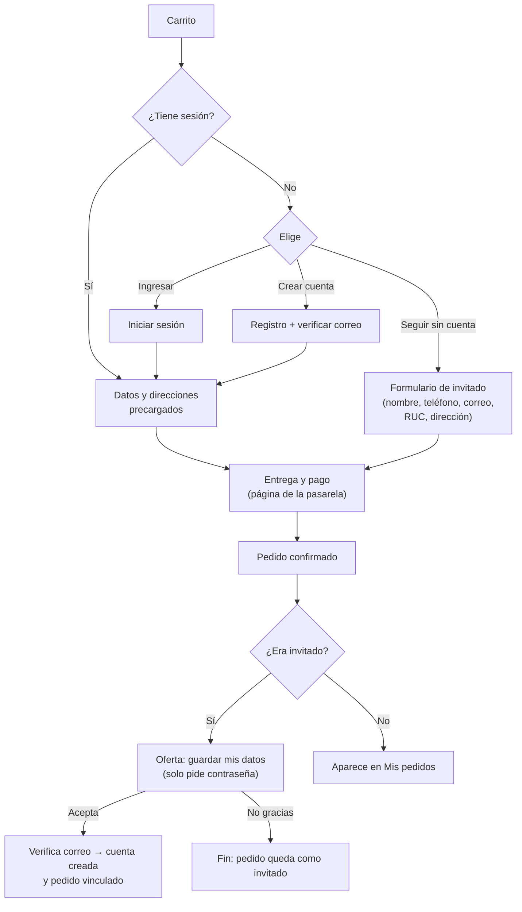

# Diseño: cuentas de cliente y compra como invitado

Estado: **cuentas implementadas** (colección, registro, ingreso, mis datos, direcciones, mis pedidos, cambio de contraseña, recuperación, baja). **Pendiente** para la fase de tienda: carrito, checkout con las tres opciones, oferta de crear cuenta tras la compra y vinculación de pedidos de invitado. Hoy la tienda está apagada en *Configuración del sitio*: las páginas de cuenta existen en `/es/cuenta` pero el menú solo muestra "Mi cuenta" cuando la tienda se activa.

## Requisito

Quien compra puede **crear una cuenta** donde queden guardados sus datos de contacto, facturación, direcciones e historial de compras, para comprar directo la próxima vez. **Sin quitar** la posibilidad de comprar sin registrarse.

## Decisiones

| # | Decisión | Por qué |
| --- | --- | --- |
| 1 | Los clientes son una **colección aparte** (`customers`), distinta de `users` (personal). | Un cliente nunca debe poder entrar al panel ni compartir permisos con el personal. Payload permite varias colecciones con inicio de sesión; el panel solo acepta `users`. |
| 2 | **Compra como invitado siempre disponible.** El pedido guarda una copia de los datos del cliente (ya lo hace `orders.customer`). | El pedido es un registro contable: no cambia aunque el cliente edite su cuenta después. |
| 3 | **Crear la cuenta es opcional**, en dos momentos: antes de pagar (iniciar sesión o registrarse) o **después de comprar** ("guardá tus datos para la próxima": solo pide una contraseña, ya tenemos el resto). | Pedir registro antes de comprar baja las ventas; ofrecerlo al final convierte mejor. |
| 4 | Un pedido de invitado se **vincula a la cuenta por correo, solo después de verificar el correo**. | Evita que alguien cree una cuenta con el correo de otra persona y vea sus compras. |
| 5 | El invitado consulta su pedido con un **enlace firmado enviado por correo** (número de pedido + código), sin cuenta. | Seguimiento sin registro y sin exponer pedidos ajenos. |
| 6 | Datos de tarjeta: **nunca** pasan por nuestro servidor. Pago en la página de la pasarela (Pagopar/Bancard). | Mantiene el alcance PCI en SAQ A. |
| 7 | Consentimiento explícito y derechos de la persona (Ley 7593/2025): ver, corregir y **eliminar su cuenta**; casilla de aceptación de privacidad con fecha. | Cumplimiento y confianza. |

## Flujo de compra

## Modelo de datos

**Colección `customers`** (`src/collections/Customers.ts`, con inicio de sesión y cookie propia `jv_customer`):

| Campo | Notas |
| --- | --- |
| Correo (usuario) | Obligatorio y único. Con SMTP configurado se exige verificarlo para poder ingresar. |
| Contraseña | Mínimo 10 caracteres. Nunca se guarda en claro (hash con sal). |
| Nombre y apellido, Teléfono o WhatsApp | Obligatorios. Contacto para el envío. |
| Facturación: tipo de documento (C.I., RUC, extranjero), número y razón social | Opcionales en el registro; se precargan en cada compra. |
| Direcciones (hasta 10) | Nombre ("Casa"), quién recibe, teléfono de entrega, dirección, referencia, ciudad, departamento, zona de entrega, enlace de Google Maps, marca "por defecto". |
| Idioma preferido | Para correos y para abrir el sitio en su idioma. |
| Aceptó la política de privacidad + fecha | Obligatorio; queda como constancia (Ley 7593/2025). |
| Acepta novedades + fecha | Opcional; se registra cuándo cambió la decisión. |
| Notas internas | Solo personal. El cliente no las ve. |

**Datos que se decidió NO guardar** (minimización de datos): fecha de nacimiento, género, datos de tarjeta o medios de pago, geolocalización exacta, documentos escaneados. Si más adelante hay un motivo de negocio, se agregan con aviso y consentimiento.

**Cambios en `orders`:**

- Nuevo campo `account` (relación opcional a `customers`). Vacío = compra de invitado.
- Se mantiene la copia de datos del cliente dentro del pedido (grupo `customer`).
- Nuevo campo `accessToken` (aleatorio, se genera en cada pedido) para el enlace de seguimiento de invitados. Ya se genera; falta la página de seguimiento.

**Permisos (resumen):**

| Quién | Cuentas (`customers`) | Pedidos (`orders`) |
| --- | --- | --- |
| Público sin sesión | Solo crear (registro) | Solo crear (checkout, vía Server Action) |
| Cliente con sesión | Ve y edita **solo la suya** | Ve **solo los suyos** |
| Personal (Admin/Gestor/Visor) | Ve y administra | Según rol, como hoy |
| Logística | Sin acceso | Solo aprobados, sin precios |

## Pantallas del sitio (implementadas)

- `/es/cuenta/ingresar`, `/es/cuenta/registro`, `/es/cuenta/olvide`, `/es/cuenta/restablecer`, `/es/cuenta/verificar` (en `es`, `en` y `pt`).
- **Mi cuenta:** datos personales, datos de facturación, libreta de direcciones.
- **Mis pedidos:** historial con estado y detalle.
- Eliminar mi cuenta (pide la contraseña; los pedidos quedan como registro contable de la tienda, ya sin vínculo con la cuenta).
- **Pendiente:** seguimiento de pedido para invitados (por enlace del correo).

## Seguridad específica

- Contraseña mínima de 10 caracteres, bloqueo tras intentos fallidos, sesión corta (la misma política que el personal).
- Registro y recuperación **no revelan** si un correo ya existe (misma respuesta siempre).
- Límite de intentos por IP en registro, ingreso y consulta de pedidos.
- Enlaces de verificación y seguimiento con vencimiento.
- Sin datos de tarjeta; sin guardar medios de pago.

## Plan de implementación

1. ✅ Colección `customers` + verificación de correo + recuperación de contraseña (el correo funciona con cualquier SMTP: variables `SMTP_*`).
2. ✅ Páginas de Ingresar, Crear cuenta, Mi cuenta, Mis pedidos.
3. Carrito y checkout con las tres opciones (ingresar, registrarse, invitado).
4. Integración con Pagopar (confirmación por webhook firmado).
5. Oferta de crear cuenta tras la compra y vinculación de pedidos por correo verificado.
6. Eliminación de cuenta y exportación de datos.

**Dependencia:** un servicio de correo (SMTP) para verificación, recuperación y seguimiento. Sin `SMTP_HOST` las cuentas quedan activas al crearse (modo desarrollo) y la recuperación de contraseña no envía nada. Falta elegir el proveedor (Resend, Postmark, Amazon SES, el correo de la empresa u otro).
