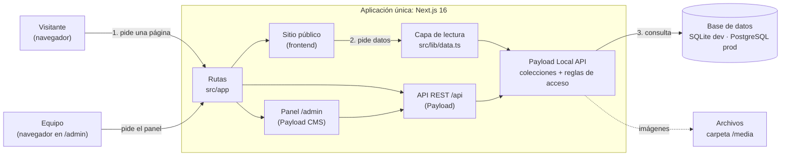
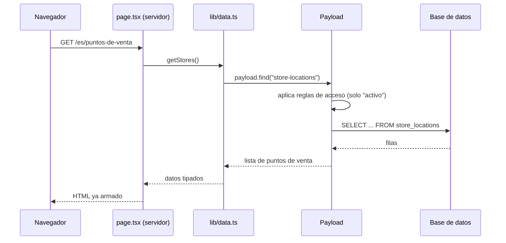
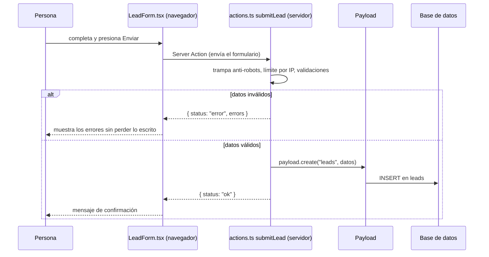
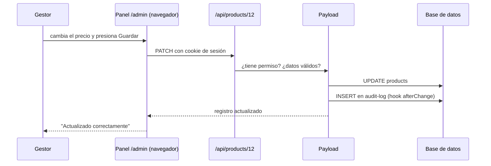

# Guía técnica: cómo funciona el sitio y su base de datos

Para quien desarrolla o mantiene el proyecto. Los diagramas usan Mermaid: GitHub y VS Code (con la extensión Markdown Preview Mermaid Support) los dibujan solos. Hay una versión visual en `docs/infografia-arquitectura.html`. La referencia completa de tecnología, tipos de API, carpetas, variables de entorno y despliegue está en `docs/MANUAL-TECNICO.md`.

## 1. El mapa general

Hay **una sola aplicación** (Next.js) que hace tres trabajos a la vez: muestra el sitio público, sirve el panel de administración y expone una API. La base de datos solo la toca el servidor; el navegador nunca habla con ella.



**Qué API usa el frontend:** el sitio público no llama a una API por HTTP. Las páginas leen los datos con funciones de Payload dentro del mismo programa (Local API) y los formularios usan Server Actions. Solo el panel `/admin` usa la API REST (`/api/...`), que también queda disponible para integraciones. GraphQL está desactivado. Detalle en `docs/MANUAL-TECNICO.md`, sección 2.

**Idea clave:** definís los datos **una vez** (en `src/collections/`) y Payload entrega, a partir de esa definición, la tabla en la base, el ABM en el panel, la API y los tipos de TypeScript. El sitio público solo *lee* esos datos y los dibuja.

## 2. Dónde vive cada cosa

| Qué | Dónde | Para qué |
| --- | --- | --- |
| Modelos de datos y ABM | `src/collections/*.ts` (listas) y `src/globals/*.ts` (pantallas únicas) | Definen campos, etiquetas en español, permisos y en qué grupo del menú aparecen. |
| Registro de modelos | `src/payload.config.ts` (lista `collections` y `globals`) | Si no está acá, no existe. |
| Permisos | `src/access/index.ts` | Reglas por rol: quién lee, crea, edita, borra. |
| Lectura para el sitio | `src/lib/data.ts` | Funciones `getProducts`, `getStores`, etc. que consultan la base. |
| Páginas públicas | `src/app/(frontend)/[locale]/...` | Cada carpeta es una URL. `[locale]` es el idioma (es, en, pt). |
| Panel y API | `src/app/(payload)/...` | Las genera Payload; casi no se toca. |
| Textos fijos | `src/lib/messages.ts` y `brand/<marca>/` | Textos de la interfaz y contenido de cada marca. |
| Tipos | `src/payload-types.ts` | Se **genera solo** con `npm run generate:types`. No editar a mano. |
| Datos iniciales | `brand/<marca>/seed.ts` + `src/scripts/seed.ts` | Carga de datos de ejemplo con `npm run seed`. |

## 3. Qué pasa cuando alguien abre una página

Ejemplo: `/es/puntos-de-venta`.



Puntos importantes:

- `page.tsx` es un **componente de servidor**: corre en el servidor, puede pedir datos directamente y manda al navegador HTML terminado. No hay "llamada a la API" desde el navegador para mostrar la página.
- `data.ts` usa `overrideAccess: false`: se aplican los permisos como si fuera una persona sin sesión. Por eso un borrador o un registro no visible **nunca** llega al sitio, aunque exista en la base.
- Los cambios del panel se ven en el sitio porque ambos leen la misma base.

## 4. Qué pasa cuando alguien hace clic

Hay dos tipos de clic, según dónde ocurre.

### 4.1 Clic en el sitio público (ejemplo real: el formulario "Para empresas")



En el código:

- `LeadForm.tsx` empieza con `'use client'`: corre en el navegador y usa `useActionState(submitLead, ...)`.
- `actions.ts` empieza con `'use server'`: la función `submitLead` **corre solo en el servidor**. Next.js crea por detrás el canal entre ambos; no hace falta escribir una ruta de API ni usar `fetch`.
- El servidor **vuelve a validar todo**, aunque el navegador ya lo haya hecho: lo que llega desde afuera no es confiable.
- Recién ahí escribe en la base con `payload.create(...)`. El público no tiene permiso de escritura sobre `leads`; por eso esa función usa `overrideAccess: true` solo después de validar.

Regla práctica: **toda acción del público que guarda algo = una Server Action que valida, limita y recién después escribe.**

### 4.2 Clic en el panel `/admin`

El panel es una aplicación React en el navegador. Cuando guardás un registro, llama a la API REST de Payload (`PATCH /api/products/12`). Payload comprueba la sesión y los permisos (`src/access/index.ts`), valida los campos, corre los hooks (por ejemplo, el que deja constancia en *Registro de actividad*) y escribe en la base.



## 5. Cómo agregar un ABM nuevo (ejemplo: Ciudades)

Un "ABM" en este proyecto es una **colección** de Payload. Crear una = tabla en la base + pantalla de alta/baja/modificación + API + tipos. Son cinco pasos.

### Paso 1. Definir el modelo

Crear `src/collections/Cities.ts`:

```ts
import type { CollectionConfig } from 'payload'
import { everyone, isAdmin, isAdminOrGestor, visibleTo } from '../access'
import { auditChange, auditDelete } from '../lib/audit'
import { slugFrom } from '../lib/slug'

export const Cities: CollectionConfig = {
  slug: 'cities', // nombre técnico: la tabla y la API (/api/cities)
  labels: { singular: 'Ciudad', plural: 'Ciudades' },
  admin: {
    useAsTitle: 'name', // qué campo se muestra como título del registro
    group: 'Contenido', // en qué grupo del menú aparece
    defaultColumns: ['name', 'department', 'active'],
    hidden: visibleTo('admin', 'gestor', 'visor'), // qué roles ven el menú
  },
  defaultSort: 'name',
  access: {
    // el público solo ve las activas; el personal ve todas
    read: ({ req: { user } }) => (user ? true : { active: { equals: true } }),
    create: isAdminOrGestor,
    update: isAdminOrGestor,
    delete: isAdmin,
  },
  hooks: { afterChange: [auditChange('cities')], afterDelete: [auditDelete('cities')] },
  fields: [
    { name: 'name', type: 'text', label: 'Nombre', required: true },
    { name: 'slug', type: 'text', label: 'Dirección web', required: true, unique: true, index: true, hooks: { beforeValidate: [slugFrom('name')] }, admin: { position: 'sidebar' } },
    { name: 'department', type: 'text', label: 'Departamento' },
    { name: 'active', type: 'checkbox', label: 'Visible en el sitio', defaultValue: true, admin: { position: 'sidebar' } },
  ],
}
```

Cada objeto de `fields` es una columna de la tabla **y** un campo del formulario del panel. Tipos habituales: `text`, `textarea`, `number`, `checkbox`, `select`, `date`, `upload` (imagen), `relationship` (vínculo con otra colección), `array` (lista repetible), `richText`.

Si el texto tiene que traducirse a inglés y portugués, agregar `localized: true` al campo (como hace `Brands`).

### Paso 2. Registrarlo

En `src/payload.config.ts`, importar la colección y sumarla a la lista:

```ts
import { Cities } from './collections/Cities'
// ...
collections: [Users, Media, Categories, Brands, Products, Certifications, Pages, Posts, StoreLocations, Cities, Leads, DeliveryZones, Orders, AuditLog],
```

### Paso 3. Crear la tabla y los tipos

```bash
npm run generate:types   # actualiza src/payload-types.ts (aparece el tipo City)
npm run dev              # en desarrollo, la tabla se crea sola al arrancar
```

Ya aparece **Ciudades** en el menú de `/admin` con su pantalla completa de alta, baja y modificación.

> **Producción:** no se crean tablas "solas". Se usan migraciones versionadas: `npm run payload migrate:create` genera el archivo y `npm run payload migrate` lo aplica. Es lo que evita perder datos al cambiar el modelo. Queda como tarea de la fase de puesta en producción.

### Paso 4. Leer los datos para el sitio

En `src/lib/data.ts`, agregar una función (misma forma que `getStores`):

```ts
import type { City } from '../payload-types'

export async function getCities(): Promise<City[]> {
  const payload = await getPayload({ config })
  const res = await payload.find({ collection: 'cities', sort: 'name', ...common, depth: 0 })
  return res.docs
}
```

### Paso 5. Mostrarlos en el frontend

Desde cualquier página de servidor, por ejemplo `src/app/(frontend)/[locale]/ciudades/page.tsx`:

```tsx
import { getCities } from '@/lib/data'

export default async function Ciudades() {
  const cities = await getCities()
  return (
    <div className="wrap">
      <h1>Ciudades</h1>
      <ul>
        {cities.map((c) => (
          <li key={c.id}>{c.name}{c.department ? `, ${c.department}` : ''}</li>
        ))}
      </ul>
    </div>
  )
}
```

La carpeta `ciudades` pasa a ser la URL `/es/ciudades`. Si la lista se usa en un **desplegable de un formulario**, se pide en la página de servidor y se pasa por props al componente de formulario del navegador.

### Conectar Ciudades con otro modelo

Para que un punto de venta o una zona de entrega elija una ciudad de la lista (en lugar de escribirla), el campo pasa a ser una relación:

```ts
{ name: 'city', type: 'relationship', relationTo: 'cities', label: 'Ciudad' }
```

En el panel aparece un buscador de ciudades. Al leer con `depth: 1` o más, el dato llega con el objeto ciudad completo. Es la forma correcta de evitar errores de tipeo ("Luque", "luque", "Luque ").

### Lista de verificación para cualquier ABM nuevo

- [ ] Etiquetas en español y grupo de menú elegidos.
- [ ] Permisos definidos: quién lee, crea, edita y borra. Lo público, solo lo necesario.
- [ ] Hook de auditoría agregado si el cambio debe quedar registrado.
- [ ] Registrado en `payload.config.ts`.
- [ ] `npm run generate:types` ejecutado y commiteado.
- [ ] Función de lectura en `data.ts` y página o componente que la usa.
- [ ] Sección nueva en `docs/MANUAL-DE-USUARIO.md`.

## 6. Comandos del día a día

| Comando | Qué hace |
| --- | --- |
| `npm run dev` | Arranca el sitio y el panel en http://localhost:3000 |
| `npm run generate:types` | Regenera los tipos después de cambiar un modelo |
| `npm run seed` | Carga los datos iniciales de la marca activa |
| `npm run typecheck` | Revisa que no haya errores de tipos |
| `npm run build` | Compila para producción |

## 7. Reglas que conviene no romper

1. **El navegador nunca habla con la base.** Siempre pasa por Payload o por una Server Action.
2. **Lo que llega del público se valida en el servidor**, siempre.
3. **Los permisos se definen en la colección**, no en la pantalla: ocultar un botón no protege nada.
4. **Un modelo nuevo cambia la base.** En producción, siempre con migración y copia de seguridad previa.
5. **Secretos en `.env`**, nunca en el código ni en git.
