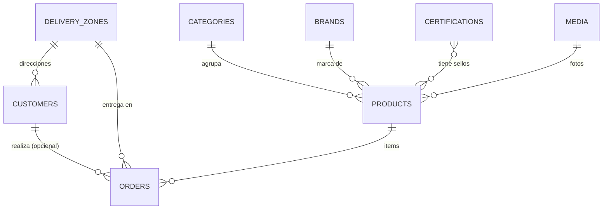

# Manual técnico

Documento de referencia para quien desarrolla, despliega o audita el sitio. Complementa a:

- `docs/GUIA-TECNICA.md`: cómo viaja un clic y cómo crear un ABM nuevo, paso a paso.
- `docs/infografia-arquitectura.html`: versión visual.
- `docs/SEGURIDAD.md`: medidas de seguridad aplicadas y pendientes.
- `docs/DISENO-CUENTAS-DE-CLIENTE.md`: cuentas de clientes y compra como invitado.
- `docs/WHITE-LABEL.md`: cómo crear el sitio de otra empresa con la misma base.

## 1. Tecnología de base

| Capa | Tecnología | Versión | Para qué se usa |
| --- | --- | --- | --- |
| Lenguaje | TypeScript | 5.7 | Todo el código, con tipos generados desde los modelos de datos. |
| Entorno de ejecución | Node.js | 20.9 o superior | Ejecuta el servidor. |
| Framework web | **Next.js** (App Router, Turbopack) | 16.4 | Rutas, páginas, formularios (Server Actions), cabeceras de seguridad. |
| Interfaz | **React** | 19 | Componentes de servidor y de navegador. |
| CMS y panel | **Payload CMS** | 3.94 | Modelos de datos, panel `/admin`, API REST, permisos, autenticación. Vive **dentro** de la misma aplicación Next.js. |
| Acceso a datos | Drizzle ORM (interno de Payload) | — | Traduce los modelos a tablas y consultas. No se usa directamente. |
| Base de datos (desarrollo) | SQLite | — | Un archivo local (`data/dev.db`); no requiere instalar nada. |
| Base de datos (producción) | PostgreSQL | 15 o superior recomendado | Se elige solo según `DATABASE_URL`. |
| Editor de texto enriquecido | Lexical (de Payload) | — | Descripciones, notas del blog, páginas. |
| Imágenes | sharp | 0.34 | Genera los tamaños de las fotos subidas. |
| Mapa | Leaflet + OpenStreetMap | 1.9 | Mapa de "Dónde comprar". Sin clave de API. Se carga solo en el navegador (`StoresMapLoader`) y los mosaicos vienen de `tile.openstreetmap.org`, permitido en la política de seguridad (`img-src` en `next.config.mjs`). |
| Correo | Nodemailer (adaptador de Payload) | — | Verificación de correo y recuperación de contraseña, por SMTP. |
| Estilos | CSS propio con variables de marca | — | Sin framework de CSS; el tema vive en `brand/<marca>/theme.css`. |
| Tipografías | Bricolage Grotesque e Instrument Sans (Fontsource) | — | Se sirven desde el propio sitio, sin pedir nada a Google. |
| Medición | Google Analytics 4 (opcional) | — | Solo se carga con consentimiento y con `NEXT_PUBLIC_GA_ID`. |

Idioma del código y comentarios: español. Idiomas del sitio: español (principal), inglés y portugués (estructura lista).

## 2. ¿Qué tipo de API consume el frontend?

**El sitio público no consume una API por HTTP.** Es la respuesta corta, y es una decisión de diseño.

| Quién | Cómo habla con los datos | Tipo | Dónde está |
| --- | --- | --- | --- |
| Páginas públicas (productos, blog, puntos de venta…) | Llaman a **funciones de Payload dentro del mismo proceso** (la "Local API") al armar la página en el servidor. No hay llamada de red ni `fetch`. | Llamada a función (en proceso) | `src/lib/data.ts` |
| Formularios del sitio (Para empresas, registro, ingreso, mis datos…) | **Server Actions** de Next.js: el formulario envía un POST y Next.js ejecuta la función del servidor. | RPC sobre POST, gestionado por Next.js | `actions.ts` junto a cada página |
| Panel `/admin` | Usa la **API REST** de Payload (`/api/<colección>`) desde el navegador. | REST + JSON | `src/app/(payload)/api/[...slug]` |
| Integraciones externas (pasarela de pago, webhooks, otros sistemas) | La misma **API REST** (`/api/...`) o una ruta propia (`route.ts`) para webhooks. | REST + JSON | Fase de pagos |
| GraphQL | **Desactivado** a propósito (`graphQL.disable: true`). | — | `src/payload.config.ts` |

**Por qué así**

- *Más rápido y simple:* mostrar una página no implica una "ida y vuelta" de red entre el sitio y la API; son funciones del mismo programa.
- *Más seguro:* la base de datos y sus reglas nunca se exponen para lo que el sitio público necesita. Cada formulario es una puerta estrecha, con validación y límite de intentos propios.
- *Menos código:* no hay que mantener una API pública, su documentación y su versionado.
- *Sin perder flexibilidad:* si mañana una app móvil o un sistema externo necesita los datos, la API REST de Payload ya existe y respeta los mismos permisos.

La API REST usa los verbos habituales y las mismas reglas de acceso que el panel:

| Operación | Ejemplo |
| --- | --- |
| Listar | `GET /api/products?where[category][equals]=3&limit=20` |
| Leer uno | `GET /api/products/12` |
| Crear | `POST /api/products` |
| Modificar | `PATCH /api/products/12` |
| Eliminar | `DELETE /api/products/12` |
| Iniciar sesión (personal) | `POST /api/users/login` |
| Iniciar sesión (cliente) | `POST /api/customers/login` |

La sesión se envía por cookie o con la cabecera `Authorization: JWT <token>`.

## 3. Estructura de carpetas

```
jerovia-web/
├── brand/                 Todo lo propio de cada marca (white-label)
│   ├── jerovia/           Textos, colores (theme.css), logos, datos iniciales
│   ├── _template/         Plantilla para una marca nueva
│   └── active.ts          Marca activa (se cambia con `npm run brand:use`)
├── docs/                  Documentación (esta carpeta)
├── scripts/               Utilidades de línea de comandos (cambio de marca, copia de imágenes)
├── src/
│   ├── access/            Reglas de permisos por rol
│   ├── app/
│   │   ├── (frontend)/    Sitio público: [locale]/ = es | en | pt
│   │   ├── (links)/       Página de enlaces para Instagram (/links)
│   │   └── (payload)/     Panel /admin y API /api (generados por Payload)
│   ├── collections/       Modelos de datos y ABM (uno por archivo)
│   ├── components/        Piezas de interfaz reutilizables
│   ├── globals/           Pantallas únicas (Configuración del sitio, Carrusel de la portada, Página de enlaces)
│   ├── lib/               Funciones de apoyo (lectura de datos, sesión, textos, auditoría)
│   ├── scripts/           Carga de datos iniciales (seed)
│   ├── payload-types.ts   Tipos generados: no editar a mano
│   └── payload.config.ts  Registro de todo (colecciones, idiomas, base de datos, correo)
├── data/                  Base SQLite local y datos de desarrollo (fuera de Git)
├── media/                 Archivos subidos (fuera de Git)
└── .env                   Secretos y configuración del entorno (fuera de Git)
```

## 4. Modelos de datos

| Colección (`slug`) | Menú del panel | Contenido | Público lee |
| --- | --- | --- | --- |
| `users` | Sistema → Usuarios | Personal con rol (admin, gestor, visor, logística) | No |
| `customers` | Ventas → Clientes | Cuentas de clientes de la tienda | Solo la propia |
| `products` | Catálogo → Productos | Productos con presentaciones, fotos, certificaciones | Publicados |
| `categories` | Catálogo → Categorías | Agrupan productos | Visibles |
| `brands` | Catálogo → Marcas | Marcas de productos | Sí |
| `certifications` | Catálogo → Certificaciones | Sellos y certificaciones | Sí |
| `store-locations` | Contenido → Puntos de venta | Dónde comprar | Visibles |
| `posts` | Contenido → Notas | Blog y prensa | Publicadas |
| `pages` | Contenido → Páginas | Páginas de texto fijo | Publicadas |
| `media` | Contenido → Imágenes | Biblioteca de fotos y logos | Sí |
| `leads` | Ventas → Solicitudes de empresas | Formularios de empresas | No |
| `delivery-zones` | Ventas → Zonas de entrega | Zonas y costos de envío | Visibles |
| `orders` | Ventas → Pedidos | Pedidos, cobros y conciliación | Solo el cliente dueño |
| `audit-log` | Sistema → Registro de actividad | Quién cambió qué | No |
| global `site-settings` | Sistema → Configuración del sitio | Datos generales, interruptor de tienda | Sí |
| global `home-carousel` | Contenido → Carrusel de la portada | Diapositivas de la portada (título, texto, imagen, sello, hasta 2 botones) | Sí |
| global `link-page` | Contenido → Página de enlaces | Página para Instagram | Sí |



Un pedido sin `account` es una compra de invitado: guarda igual una copia de los datos del comprador.

## 5. Autenticación y permisos

Hay **dos tipos de sesión independientes**:

| | Personal (`users`) | Cliente (`customers`) |
| --- | --- | --- |
| Entra por | `/admin` | `/es/cuenta/ingresar` |
| Cookie | La de Payload (`payload-token`) | `jv_customer` (propia) |
| Duración | 2 horas | 7 días |
| Roles | admin, gestor, visor, logística | Ninguno: solo accede a lo suyo |
| Bloqueo por intentos | 5 intentos, 10 min | 5 intentos, 10 min |
| Contraseña | — | Mínimo 10 caracteres |

Los permisos se definen **en cada colección** (`access`) con las funciones de `src/access/index.ts`. Regla clave: una sesión de cliente nunca se confunde con la de personal (`isStaffUser` revisa de qué colección viene la sesión). Esto se probó contra la API REST: un cliente no puede leer cuentas o pedidos ajenos, usuarios del personal ni el registro de actividad.

## 6. Variables de entorno (`.env`)

| Variable | Obligatoria | Para qué |
| --- | --- | --- |
| `PAYLOAD_SECRET` | Sí (mín. 32 caracteres en producción) | Firma las sesiones. La aplicación no arranca en producción sin ella. |
| `NEXT_PUBLIC_SERVER_URL` | Sí | Dirección pública del sitio. |
| `NEXT_PUBLIC_DEFAULT_LOCALE` | No | Idioma por defecto (`es`). |
| `DATABASE_URL` | Sí | `file:./data/dev.db` (desarrollo) o `postgres://...` (producción). |
| `NEXT_PUBLIC_GA_ID` | No | Google Analytics 4. Vacío = sin medición. |
| `SMTP_HOST`, `SMTP_PORT`, `SMTP_SECURE`, `SMTP_USER`, `SMTP_PASSWORD`, `SMTP_FROM`, `SMTP_FROM_NAME` | Producción | Correo. Con `SMTP_HOST` se exige verificar el correo de las cuentas. |
| `SEED_ADMIN_EMAIL`, `SEED_ADMIN_PASSWORD`, `SEED_DEMO_USERS` | Solo `npm run seed` | Primer administrador y usuarios de ejemplo (solo desarrollo). |

Los secretos nunca van en el código ni en Git. En producción se cargan en el panel del proveedor de hosting.

## 7. Entornos y despliegue

| | Desarrollo | Producción |
| --- | --- | --- |
| Comando | `npm run dev` | `npm run build` y `npm start` |
| Base de datos | SQLite, tablas creadas solas | PostgreSQL, **migraciones** versionadas |
| Correo | Opcional | Obligatorio |
| Archivos subidos | Carpeta `media/` | Almacenamiento persistente (disco o servicio de objetos) |

**Abrir el sitio de desarrollo desde otro equipo (celular, otra PC).** Se entra por la IP de la red, por ejemplo `http://192.168.100.74:3000`. Next.js bloquea en desarrollo los recursos internos que vienen de direcciones no declaradas, y entonces la página se ve pero no se activa (el menú no se achica, los formularios no responden). Por eso `next.config.mjs` declara `allowedDevOrigins` con los rangos de red local (`192.168.*.*`, `10.*.*.*`, `172.16.*.*`). Si la red usa otro rango, se agrega ahí y se reinicia `npm run dev`. En producción no tiene efecto.

Antes de publicar (detalle en `docs/SEGURIDAD.md`):

1. PostgreSQL gestionado con copias de seguridad automáticas y prueba de restauración.
2. Migraciones: `npm run payload migrate:create` al cambiar un modelo y `npm run payload migrate` al desplegar.
3. Variables de entorno de producción (claves nuevas, no las de desarrollo).
4. Servicio de correo configurado.
5. Dominio con HTTPS; WAF/CDN delante (por ejemplo Cloudflare).
6. Almacenamiento persistente para `media/`.
7. Páginas legales y política de privacidad revisadas.

## 8. Flujo de trabajo con Git

- La rama `main` siempre debe compilar: `npm run typecheck` y `npm run build` sin errores.
- Un cambio de modelo implica: archivo de la colección, `npm run generate:types`, migración (producción) y sección en `docs/MANUAL-DE-USUARIO.md`.
- Los commits terminan con la línea de autoría que corresponda; los mensajes describen el *porqué*.
- `.env`, `data/`, `media/` y `public/brand/` están en `.gitignore`.

## 9. Pendientes técnicos conocidos

| Tema | Estado |
| --- | --- |
| Carrito, checkout y pasarela de pagos (Pagopar) con webhook firmado | Pendiente (próxima fase) |
| Pedidos de invitado: seguimiento por enlace y vinculación a la cuenta | Pendiente (el código secreto del pedido ya se genera) |
| Migraciones de base de datos y PostgreSQL | Pendiente (puesta en producción) |
| Doble factor para el personal | Pendiente |
| Límite de intentos compartido entre servidores | Hoy en memoria; pasar a un almacén compartido o al WAF |
| Traducciones `en` y `pt` del contenido del catálogo | Estructura lista; falta cargar los textos |
| Tarjetas de producto y colecciones de Fortunata y Surya Henna | Hoy solo como botones de la página de enlaces |
